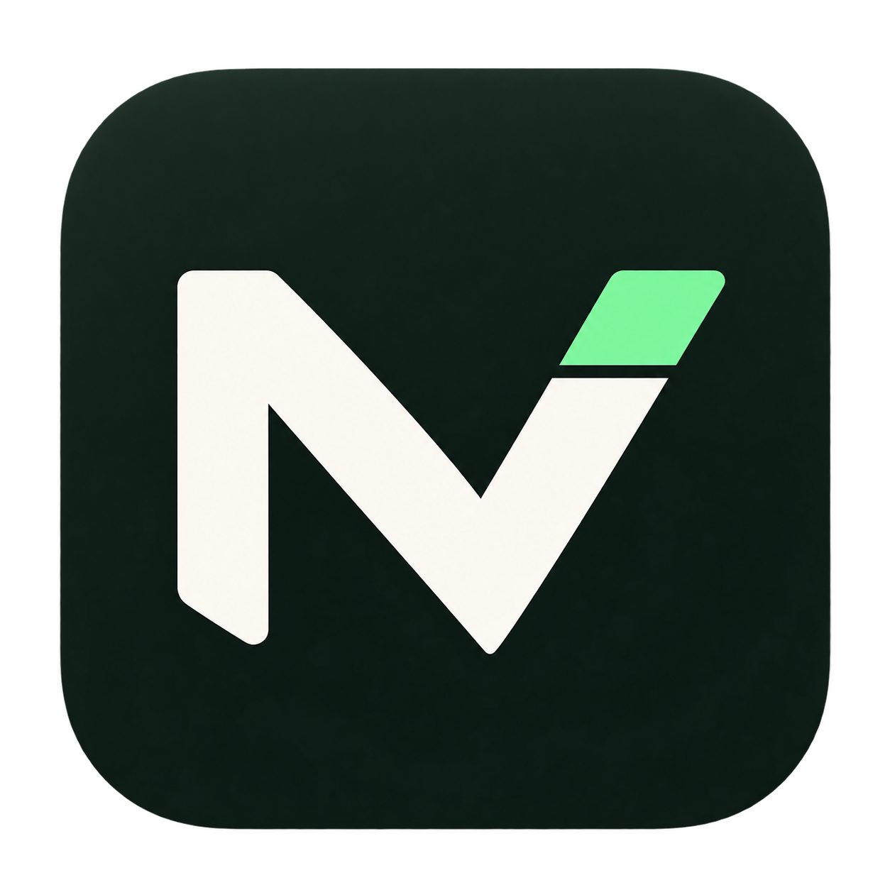
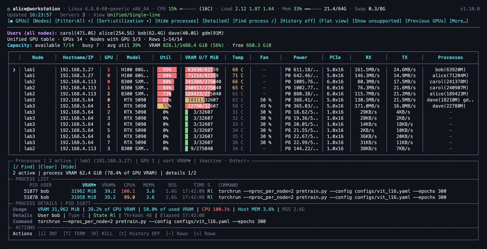
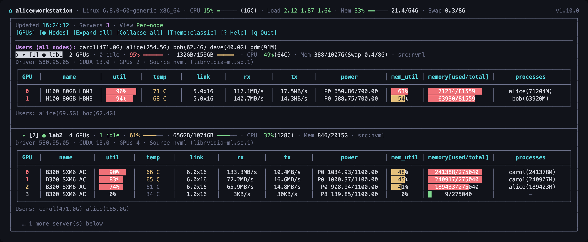
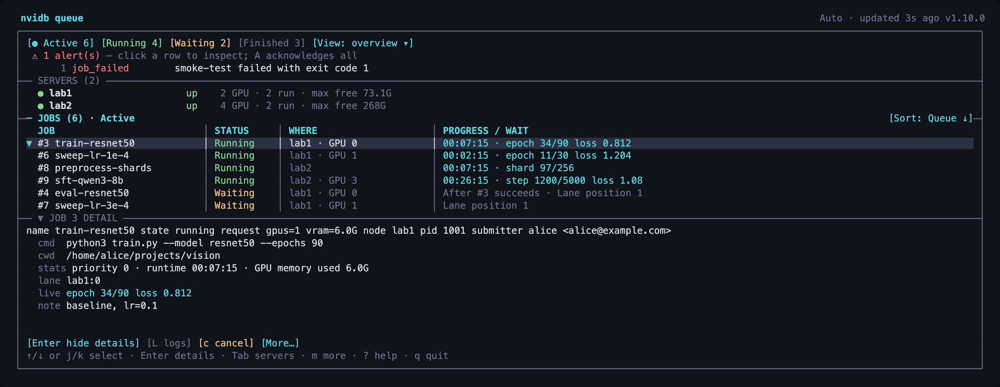
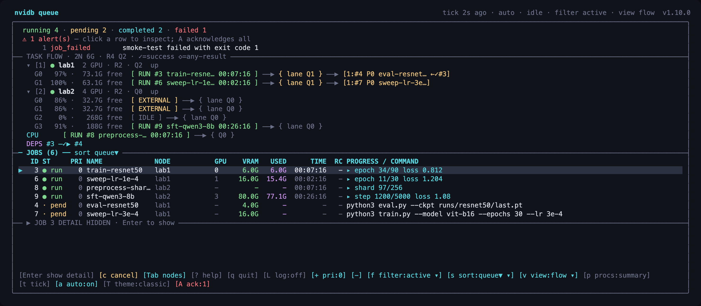
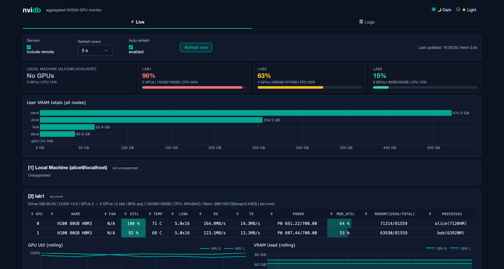
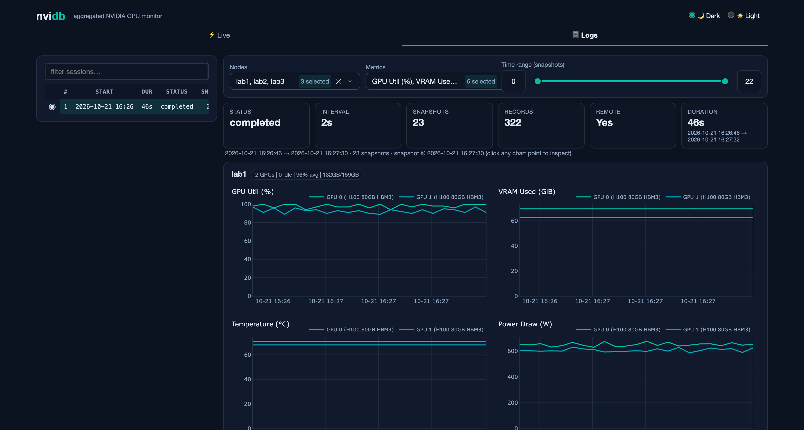

<p align="center">
  
</p>

<h1 align="center">nvidb</h1>

<p align="center">
One terminal for every NVIDIA GPU you can SSH to — monitor them, log them, and queue jobs onto them.
</p>

<p align="center">
  
</p>

## Highlights

- **All your servers, one screen.** `nvidb --remote` shows every GPU on every
  configured host, live. Sort, filter and group cards, or switch to per-node panels.
- **Nothing to install on the nodes.** Remote stats come from NVML through a
  standard-library Python agent over SSH. ProxyJump and `~/.ssh/config` import
  work out of the box; slow or offline hosts never stall the others.
- **See who is on each GPU.** Per-GPU process lists with owner, VRAM and full
  command, utilization history, and SIGINT / SIGTERM / SIGKILL from the TUI.
- **A GPU job queue without a daemon.** `nvidb job submit --vram 20G -- python train.py`
  waits until a card has room, runs the job detached on the node, and reports back.
  Per-GPU lanes, `--after` dependencies, pools, priorities, notes and live progress included.
- **Logs and a web dashboard.** `nvidb log` records sessions to SQLite;
  `nvidb web` charts them and shows the live cluster in the browser.
- **Built for scripts and agents.** Queue commands speak `--json`, and
  [`skills/nvidb-queue`](skills/nvidb-queue/SKILL.md) teaches coding agents to use the queue.

## Quick start

```bash
pip install nvidb          # or: pip install .   (add `dash` for the web dashboard)
nvidb add                  # add a server interactively (or: nvidb import ~/.ssh/config)

nvidb --remote             # live monitor of local + remote GPUs
nvidb log --remote         # record GPU stats to SQLite
nvidb web                  # web dashboard at http://localhost:8501

nvidb job submit --vram 20G -- python train.py   # queue a job
nvidb queue                                      # watch the queue
```

Servers live in `~/.nvidb/config.yml` (see [config.example.yml](config.example.yml)).
Requires Python 3.9+ and an NVIDIA driver with NVML; remote hosts need only Python 3.9+ and SSH.

## Screenshots

**Per-node view** (`v` in the monitor)



**Job queue** (`nvidb queue`) — overview, and the task-flow view with lanes and dependencies





**Web dashboard** (`nvidb web`) — live cluster and recorded log sessions





## Documentation

- [Monitor, logging and web dashboard](docs/monitor.md) — configuration, every
  command, TUI key bindings, the `@nvidb.monitor` decorator
- [Cluster job queue](docs/queue.md) — scheduling rules, submitting and watching
  jobs, lanes, alerts, the queue TUI, running the queue on an always-on host

## Acknowledgements

Built on NVIDIA NVML and [nvidia-ml-py](https://pypi.org/project/nvidia-ml-py),
[Paramiko](https://github.com/paramiko/paramiko), [blessed](https://github.com/jquast/blessed),
[Dash](https://github.com/plotly/dash) / [Plotly](https://github.com/plotly/plotly.py),
[pandas](https://github.com/pandas-dev/pandas), [PyYAML](https://github.com/yaml/pyyaml) and
[termcolor](https://github.com/termcolor/termcolor). Thanks to
[nvitop](https://github.com/XuehaiPan/nvitop) for showing how to poll NVML efficiently.
